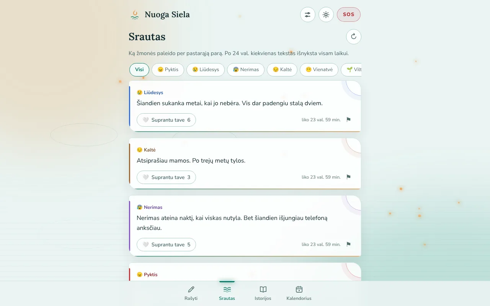
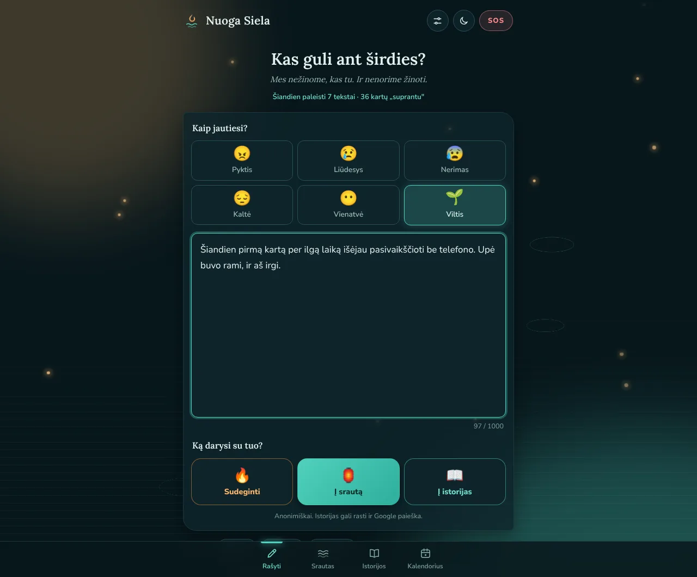
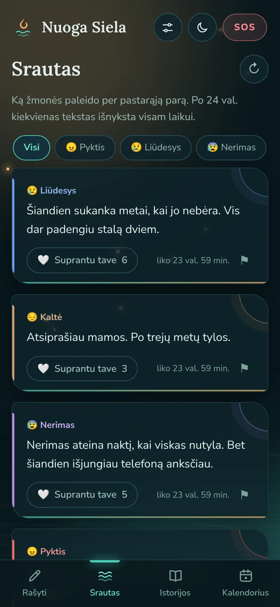

<p align="right"><a href="README.md">English</a> · <strong>Lietuviškai</strong></p>

# 🔥🌊 Nuoga Siela

**Anoniminė erdvė išsilieti: parašyk, ką jauti, tada sudegink arba paleisk upe. Mes nežinome, kas
tu, ir nenorime žinoti.**

🌐 **Gyva svetainė:** [nuogasiela.lt](https://nuogasiela.lt) · 💻 **Kodas:**
[github.com/brutall100/nuoga-siela](https://github.com/brutall100/nuoga-siela)



| Tamsus režimas                                               | Telefonas (390px)                                                          |
| ------------------------------------------------------------ | -------------------------------------------------------------------------- |
|  |  |

## Apie projektą

Kartais reikia tiesiog išsakyti, kas slegia, bet niekam nepasakojant. Nuoga Siela yra būtent tam.
Nereikia registruotis, nėra vardų ir nėra komentarų. Kiti gali tik paspausti „Suprantu tave“.

Dizainą įkvėpė Joninių tradicija: naktį žmonės paleidžia upe vainikus ir žiburius, ir kas sunku,
nuplaukia. Ugnis skirta deginimui, vanduo skirtas paleidimui.

### Kaip tai veikia

1. **Pažymėk, kaip jautiesi** (iš anksto pažymėta viltis). Emocija atsiras tavo kalendoriuje, tik
   šiame įrenginyje.
2. **Išliek žodžius.** Be vardo ir be registracijos.
3. **Nuspręsk, ką su jais daryti:** 🔥 sudeginti (niekas nepamatys), 🏮 paleisti į **Srautą** (po 24
   val. išnyks) arba 📖 palikti **istoriją** (lieka, kol pats ištrini).

Apatinis meniu seka tą patį kelią: **Rašyti → Srautas → Istorijos → Kalendorius**. Nustatymai
pasiekiami ⚙ mygtuku viršuje.

## Funkcijos

- ✍️ **Rašyk laisvai.** Pasirink emociją — kiekviena nupiešta kaip kosmoso reiškinys: pyktis
  (susiduriančios planetos), liūdesys (krentanti žvaigždė), nerimas (nerimstančios orbitos), kaltė
  (užtemimas), vienatvė (viena planeta), viltis (žvaigždė virš horizonto). Tie patys simboliai
  rodomi sraute, istorijose ir kalendoriuje; pažymėtas — juda.
- 🔥 **Sudegink.** Tekstas virsta žarijomis ir išnyksta. Į serverį jis niekada nesiunčiamas.
- 🏮 **Paleisk** į **Srautą**: po 24 val. tekstas fiziškai ištrinamas. Istoriją galima tuo pačiu
  paleisti ir į srautą (vienas žymimasis langelis). Abiem atvejais — iki 5000 ženklų.
- 📖 **Palik istoriją**: tekstas lieka, kol pats ištrini, ir turi savo puslapį.
- 🤍 **„Suprantu tave“.** Palaikymas be komentarų, vienas balsas vienam įrenginiui.
- 🆘 **SOS.** Pagalbos linijos ir kvėpavimo ratas. Jei tekste yra krizės žodžių, pagalba pasiūloma
  švelniai, bet tekstas neblokuojamas.
- 🔊 **Šauksmo kambarys** (SOS ekrane). Garsas įrašomas tik į telefono atmintį ir niekur
  nesiunčiamas.
- 📅 **Emocijų kalendorius** (apatiniame meniu). Tavo pažymėtos emocijos pagal dienas ir šios
  savaitės juosta; paleidus ar sudeginus tekstą, simbolis nuskrenda į kalendorių. Saugoma tik diena
  ir emocija, tik tavo įrenginyje. Šalia — kaip šią savaitę jaučiasi visi (tik suminiai skaičiai, be
  jokio ryšio su žmonėmis).
- 🎧 **Raminantys garsai.** Upė, lietus ar laužas rašant ir kvėpuojant.
- 🌗 **Šviesus ir tamsus režimas.** Seka sistemos nustatymą, turi perjungimo mygtuką ir nemirga
  kraunantis.
- 🌊 **Gyvas fonas.** Plečiasi vandens ratilai, kyla žibintų švieselės, lėtai plaukia švytėjimai.
  Telefone dalelių perpus mažiau, o su `prefers-reduced-motion` jos išjungiamos.
- 🌍 **LT / EN kalbos**, PWA (galima įdiegti į telefoną), SEO (sitemap, Atom feed, istorijų
  puslapiai).

### Anonimiškumas užtikrintas technologija, ne tik pažadu

- Įrenginio ID sukuriamas naršyklėje (`crypto.randomUUID()`). Serveris jį iš karto paverčia
  `sha256(druska + uuid)`, o originalo niekur nesaugo.
- IP adresai nesaugomi. Serverio žurnale lieka tik `metodas kelias statusas`.
- Srauto įrašai kuriami su `expireIn: 24h`, todėl Deno KV juos fiziškai ištrina pats.
- Šriftai laikomi pačiame projekte, todėl Google nemato lankytojų.

## Sukurta su

| Sritis   | Kas                                                                                                                   |
| -------- | --------------------------------------------------------------------------------------------------------------------- |
| Serveris | [Deno](https://deno.com) 2 + Deno KV, nulis priklausomybių                                                            |
| Klientas | Vanilla HTML / CSS / JS (PWA), jokių bibliotekų ir jokio build žingsnio                                               |
| Šriftai  | [Lora](https://fonts.google.com/specimen/Lora) antraštėms, [Nunito](https://fonts.google.com/specimen/Nunito) tekstui |
| Testai   | `deno test`, CI per GitHub Actions (fmt + lint + test)                                                                |

**Spalvų paletė „Paleisk upe“** (visos spalvos yra `public/css/main.css` viršuje, `:root`):

| Vaidmuo           | Tamsus    | Šviesus   |
| ----------------- | --------- | --------- |
| Fonas             | `#08171C` | `#EAF4F2` |
| Paviršius         | `#0F242B` | `#FFFFFF` |
| Tekstas           | `#E4F1EE` | `#10292E` |
| Akcentas (vanduo) | `#4FD1BD` | `#0B7A6A` |
| Antras (žibintas) | `#FFB86B` | `#E08A33` |

Visi kontrastai patikrinti pagal WCAG: paprastas tekstas turi bent 4.5:1, UI elementai bent 3:1.

## Ko išmokau

- Kaip anonimiškumą užtikrinti **architektūra**: hash'ai vietoj ID, TTL vietoj „paslėpta“ žymės,
  jokių IP žurnaluose.
- Kaip Deno KV su atvirkštiniu laiko žymeniu ID pradžioje grąžina naujausius įrašus be jokio
  indekso.
- Kaip SPA su tikrais URL keliais (`history.pushState`) ir serverio atrenderintais puslapiais tampa
  matoma Google.
- Kaip padaryti gyvą foną, kuris neapkrauna procesoriaus: animuojami tik `transform` ir `opacity`,
  dalelės sukuriamos vieną kartą.
- Kaip griežtas CSP (`script-src 'self'`) keičia įpročius: jokių inline skriptų ar stilių, tema
  nustatoma atskiru failu `<head>` dalyje.

## Paleisk savo kompiuteryje

Reikia [Deno 2](https://docs.deno.com/runtime/getting_started/installation/).

```bash
git clone https://github.com/brutall100/nuoga-siela.git
cd nuoga-siela
cp .env.example .env   # nebūtina lokaliai; produkcijoje pakeisk DEVICE_SALT
deno task dev          # http://localhost:8000
```

`.env` faile gali pakeisti `PORT`, `DEVICE_SALT` (produkcijoje būtinai įrašyk ilgą atsitiktinę
eilutę: `openssl rand -hex 32`), `POST_TTL_MS`, `KV_PATH` ir `INDEXNOW_KEY`. Visi paaiškinti
`.env.example` faile.

Kitos komandos:

```bash
deno task test   # serverio testai
deno task lint   # lint (main.ts + server/)
deno fmt         # formatavimas
```

> Projektui reikia serverio (Deno + KV), todėl GitHub Pages jo nepaleistų. Gyva versija veikia
> [Deno Deploy](https://deno.com/deploy) platformoje, adresu [nuogasiela.lt](https://nuogasiela.lt).
> Deploy: dash.deno.com → New Project → šis repo → entrypoint `main.ts` → nustatyk `DEVICE_SALT`.

## Projekto struktūra

```
main.ts              serveris: statika, /api, SSR istorijų puslapiai, sitemap, Atom, CSP
server/api.ts        API (JSON)
server/store.ts      Deno KV: įrašai, istorijos, „suprantu“, rate limit, statistika
server/filter.ts     šlamšto / asmens duomenų filtras ir krizės žodžių atpažinimas
public/index.html    vienas puslapis su visais ekranais
public/css/main.css  dizaino sistema ir paletė (:root)
public/js/theme.js   šviesus / tamsus režimas (be mirgėjimo)
public/js/river.js   gyvas fonas (ratilai, žibintai)
public/js/ui.js      bangelė mygtukuose, atsiradimas slenkant, skaičiavimas
public/js/app.js     maršrutai, rašymas, srautas, istorijos, nustatymai
public/js/burn.js    deginimo animacija (Canvas)
public/js/scream.js  Šauksmo kambarys (garsas tik RAM'e)
public/js/icons.js   emocijų simboliai (kosmoso reiškiniai) ir linijinės ikonos
public/js/mood.js    emocijų kalendorius (tik įrenginyje) ir bendra savaitės nuotaika
public/js/sounds.js  raminantys garsai (Web Audio kilpa, failai public/sounds/)
public/fonts/        Lora ir Nunito (woff2 + OFL licencijos)
public/sounds/       upės, lietaus ir laužo kilpos (Freesound, CC0)
public/images/       og-image.webp
docs/                ekrano nuotraukos README failui
```

### API

| Metodas | Kelias                        | Kas                                                                     |
| ------- | ----------------------------- | ----------------------------------------------------------------------- |
| `POST`  | `/api/posts`                  | `{text, emotion, kind}` + `X-Device`. Grąžina `sos: true` krizės atveju |
| `GET`   | `/api/posts?emotion=`         | srautas, naujausi viršuje                                               |
| `GET`   | `/api/stories?emotion=&sort=` | istorijos (`suprastos` arba `naujausios`)                               |
| `GET`   | `/api/mine`                   | mano tekstai su „suprantu“ skaičiais                                    |
| `GET`   | `/api/stats`                  | `{postsToday, hugsToday}`                                               |
| `GET`   | `/api/mood`                   | `{counts, total}`: kiek kartų per 7 dienas pažymėta kiekviena emocija   |
| `POST`  | `/api/posts/:id/hug`          | „Suprantu tave“ (vieną kartą įrenginiui)                                |
| `POST`  | `/api/posts/:id/report`       | pranešti; po 3 pranešimų įrašas paslepiamas automatiškai                |
| `POST`  | `/api/mine/delete`            | ištrinti visus savo įrašus                                              |

## Padėkos

- Šriftai: [Lora](https://github.com/cyrealtype/Lora-Cyrillic) (The Lora Project Authors) ir
  [Nunito](https://github.com/googlefonts/nunito) (The Nunito Project Authors), abu pagal
  [SIL Open Font License 1.1](https://openfontlicense.org). Licencijų tekstai yra `public/fonts/`.
- Garsai iš [Freesound](https://freesound.org), visi
  [CC0 1.0](https://creativecommons.org/publicdomain/zero/1.0/):
  [Murmuring Stream](https://freesound.org/people/borralbi/sounds/337614/) (borralbi),
  [Rain light 2 (rural)](https://freesound.org/people/jmbphilmes/sounds/200273/) (jmbphilmes),
  [campfire in a forest at night](https://freesound.org/people/Duophonic/sounds/248303/)
  (Duophonic). Sukarpyti į 90 s kilpas, plačiau `CHANGELOG.md` (v2.6).
- Pagalbos linijos: [Vilties linija](https://www.viltieslinija.lt) 116 123,
  [Jaunimo linija](https://www.jaunimolinija.lt) 8 800 28888.
- Idėjos: Vent, 7 Cups, Jodel. Psichologinis pagrindas: J. Pennebaker (ekspresyvusis rašymas).

## Licencija

[AGPL-3.0](LICENSE) © 2026 brutall100

Paprastai tariant: kodą gali naudoti, keisti ir dalinti, bet jei paleidi pakeistą versiją kaip
svetainę ar paslaugą, savo kodą turi atverti jos naudotojams pagal tą pačią licenciją.

Pavadinimui **„Nuoga Siela“** ir logotipui licencija netaikoma. Kituose projektuose juos naudoti
galima tik gavus leidimą.
